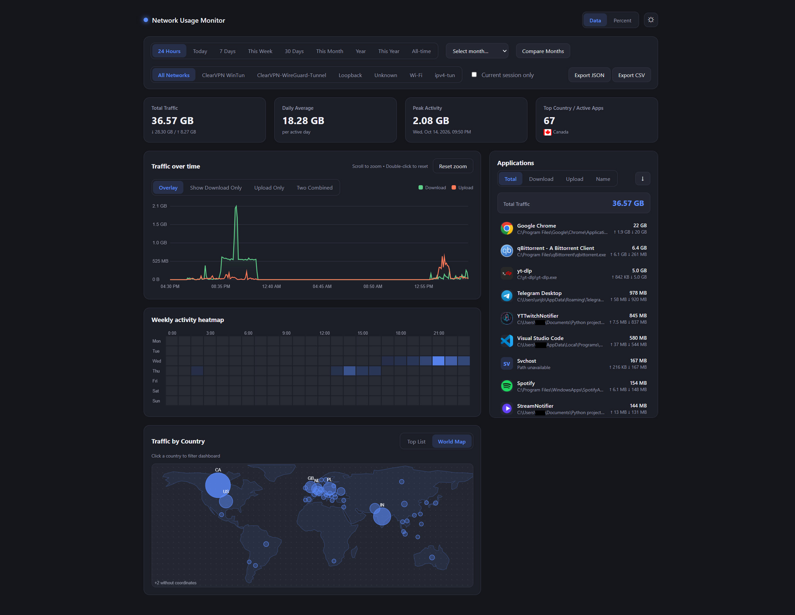
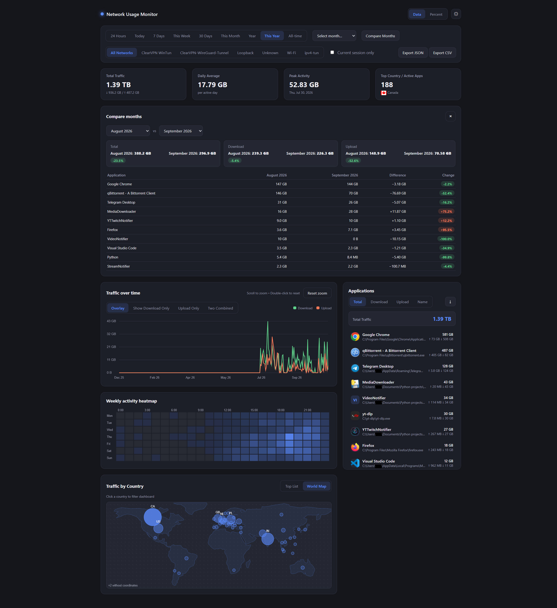
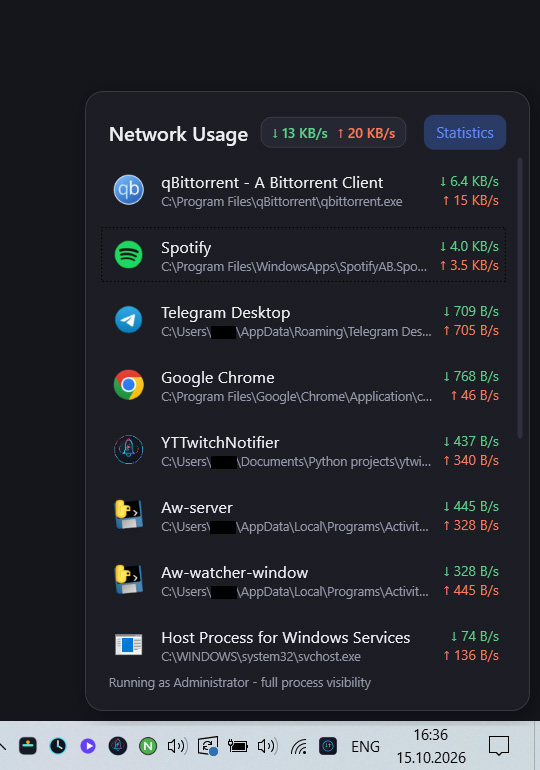

# 📡 Network Usage Monitor

[](https://dotnet.microsoft.com/download/dotnet/8.0)
[](https://learn.microsoft.com/dotnet/csharp/)
[](https://learn.microsoft.com/dotnet/desktop/wpf/)
[%20%7C%2011-0078d4.svg)](https://www.microsoft.com/windows)
[](#-requirements)
[](https://github.com/microsoft/perfview/tree/main/src/TraceEvent)
[](https://www.sqlite.org/)
[-green.svg)](https://github.com/sapics/ip-location-db)
[](https://ai.google.dev/)
[](https://docs.anthropic.com/)
[](https://opensource.org/licenses/MIT)

> 🤖 **Note:** This project was written with the assistance of Artificial Intelligence. Created to demonstrate modern AI-assisted development.

A lightweight, self-contained Windows tray utility (C#, .NET 8, WPF) that shows **real-time per-application bandwidth**, tracks **traffic by country** with an **offline GeoIP database**, splits traffic by **network adapter** (Wi-Fi, Ethernet, …) and ships a **local analytics dashboard**.

> Everything runs on your machine. No cloud, no accounts, no external API calls during packet analysis.

## 📌 Table of Contents

- [Screenshots](#-screenshots)
- [Features](#-features)
- [Requirements](#-requirements)
- [Quick Start](#-quick-start)
- [Autostart (Task Scheduler)](#-autostart-task-scheduler)
- [Build & publish](#-build--publish)
- [Dashboard API](#-dashboard-api)
- [Architecture](#-architecture)
- [How it works](#-how-it-works)
- [Data storage](#-data-storage)
- [Limitations](#-limitations)
- [Troubleshooting](#-troubleshooting)

---

## 🖼️ Screenshots

**Dashboard**



**Compare Months**



**Tray flyout**



---

## ✨ Features

### 🔵 Tray flyout

- **Per-process speeds** from kernel ETW events, grouped by application with expandable child PIDs (download ↓ and upload ↑ per PID).
- **Total speed badge** with live system-wide ↓ / ↑.
- **Icons**: real `.exe` icons, with colored initials as a fallback.
- **DPI-aware positioning** next to the tray (`MonitorFromRect` / `GetDpiForMonitor`), correct on multi-monitor setups with mixed scaling.
- **Resilient**: the ETW session restarts automatically after sleep/hibernate; UI updates are pushed asynchronously (`BeginInvoke`).
- **Tray menu**: *Statistics* (opens the dashboard), *Open settings file*, *Exit program*.
- **Single instance** (named mutex); unhandled errors are written to `error.log`.

### 🌍 Offline GeoIP & Traffic by Country

- **Local country resolution** (`GeoIpResolver`): public IPv4 and IPv4-mapped IPv6 addresses → ISO country code, no HTTP requests during analysis.
- **Allocation-free lookups** in the hot ETW path via `Array.BinarySearch` over in-memory ranges.
- **Special codes**: `local` for private/loopback/multicast/link-local addresses, `unk` for addresses that can't be resolved.
- **Traffic by Country card**: Top List (flags, bars, upload/download, connection counts) and a Canvas World Map. Clicking a country filters the **whole dashboard** (charts, KPIs, apps); a badge resets it.

### 📊 Web dashboard

- **Ranges**: 24 Hours, Today, 7 Days, This Week, 30 Days, This Month, Year, This Year, All-time, or any **specific month** from a picker. Calendar ranges use local time.
- **Filters**: network adapter (All Networks / Wi-Fi / Ethernet / …), country, and **Current session only**.
- **Auto-refresh** every 15 s; timelines are **zero-filled** (gaps from sleep/power-off) and future time is trimmed.
- **Compare Months**: KPI cards (Total, Download, Upload, daily average) with ±% delta badges and a top-10 application table with byte differences.
- **Interactive charts** (dependency-free Canvas): Overlay / Download only / Upload only / Two Combined modes, wheel zoom, drag-to-zoom, double-click reset, tooltip with crosshair, and a 7×24 weekly heatmap.
- **KPI strip**: Total Traffic (↑/↓ split), Daily Average, Peak Activity, Top Country / Active Apps.
- **Applications list**: sort by Total / Download / Upload / Name with direction toggle; absolute bytes or percent.
- **Application details modal**: total, share of all traffic, peak day, mini-chart, top countries, **live connections** (protocol, country, remote IP/port, local port) and *Reveal in Explorer*.
- **Export** history for the selected range as `.json` or `.csv`.
- **Light/dark theme**, remembered in `localStorage`.

### 🗄️ SQLite maintenance

- **Hourly rollup**: 15-second rows older than 48 h are compacted into hourly buckets (`usage_samples`, `country_samples`).
- **Short-lived processes** that can't be resolved are grouped as `Background / Short-lived` instead of creating many `Pid-XXXX` rows (old rows are renamed during maintenance).
- **Schedule**: every 6 hours, plus a check on batch writes in case the PC was asleep.
- **Space reclaim**: `wal_checkpoint(TRUNCATE)` + `VACUUM` when more than 5000 rows were compacted/renamed.
- **Settings**: `journal_mode=WAL`, `synchronous=NORMAL`, `busy_timeout=5000`, so the dashboard can read while the writer is active.
- **Migrations**: legacy `country_usage` → `country_samples`. ⚠️ A very old schema with `interface_category` (data-cap / app-category builds) can't be mapped to the adapter-based schema, so that `usage_samples` table is **dropped and rebuilt**.

---

## 🧰 Requirements

- Windows 10 (19041+) or Windows 11, **x64**
- **.NET 8 SDK** only to build from source (the published app is self-contained)
- **Administrator rights** at runtime (kernel ETW sessions; see [How it works](#-how-it-works))

## 🚀 Quick Start

1. Download `NetworkUsageMonitor.exe` from [Releases](https://github.com/BlackPencil-69/NetworkUsageMonitor/releases) into a permanent folder, e.g. `C:\Tools\NetworkUsageMonitor\`.
2. Run it and confirm the UAC prompt.
3. Click the tray icon for the flyout; right-click it → **Statistics** for the dashboard (`http://127.0.0.1:58765/` by default).

---

## 🔁 Autostart (Task Scheduler)

The `Startup` folder and registry `Run` key start programs *without* elevation, so they either trigger UAC at every login or fail. A scheduled task with **highest privileges** starts the app silently.

### Option A — PowerShell (Administrator, laptop-friendly)

```powershell
$exe     = "C:\Tools\NetworkUsageMonitor\NetworkUsageMonitor.exe"
$action  = New-ScheduledTaskAction -Execute $exe -WorkingDirectory (Split-Path $exe)
$trigger = New-ScheduledTaskTrigger -AtLogOn -User $env:USERNAME
$trigger.Delay = "PT30S"
$principal = New-ScheduledTaskPrincipal -UserId $env:USERNAME -LogonType Interactive -RunLevel Highest
$settings  = New-ScheduledTaskSettingsSet `
    -AllowStartIfOnBatteries -DontStopIfGoingOnBatteries `
    -ExecutionTimeLimit ([TimeSpan]::Zero) `
    -MultipleInstances IgnoreNew

Register-ScheduledTask -TaskName "NetworkUsageMonitor" `
    -Action $action -Trigger $trigger -Principal $principal -Settings $settings -Force
```

### Option B — One command (Administrator CMD)

```bat
schtasks /Create /TN "NetworkUsageMonitor" /TR "\"C:\Tools\NetworkUsageMonitor\NetworkUsageMonitor.exe\"" /SC ONLOGON /RL HIGHEST /DELAY 0000:30 /F
```

> ⚠️ This uses default conditions: on laptops the task will *not* start on battery and is stopped after 3 days. Use Option A, or fix both in `taskschd.msc` (**Conditions** → uncheck the AC-power options; **Settings** → uncheck *Stop the task if it runs longer than*).

### Option C — GUI (`taskschd.msc` → Create Task…)

- **General**: ✅ *Run with highest privileges* (skips UAC), *Run only when user is logged on*.
- **Triggers**: *At log on*, your user, ✅ *Delay task for 30 seconds*.
- **Actions**: *Start a program* → path to the exe, *Start in* → its folder (no quotes).
- **Conditions / Settings**: uncheck the AC-power options and the execution time limit; *If the task is already running* → `Do not start a new instance`.

### Managing

```bat
schtasks /Run /TN "NetworkUsageMonitor"
schtasks /End /TN "NetworkUsageMonitor"
schtasks /Change /TN "NetworkUsageMonitor" /DISABLE
schtasks /Delete /TN "NetworkUsageMonitor" /F
```

Replacing the exe **at the same path** keeps the task working; close the running instance from the tray first (the file is locked).

| Problem | Fix |
|---------|-----|
| Nothing starts at logon | Check the task's **History** tab and the exe path. |
| UAC prompt every time | *Run with highest privileges* is off, or a Startup folder/registry entry is used. |
| Doesn't start on battery / stops after days | Uncheck the AC-power conditions and the time limit. |
| Tray icon missing after login | Increase the logon delay to 45–60 s. |

---

## 🛠️ Build & publish

```powershell
cd src
dotnet restore
dotnet run          # run the terminal as Administrator (app.manifest requires elevation)

dotnet publish -c Release
```

Output: `src\bin\Release\net8.0-windows10.0.19041.0\win-x64\publish\NetworkUsageMonitor.exe` — one file, no external DLLs or assets. All these properties are already set in the `.csproj`, so a plain `dotnet publish -c Release` gives the same result.

---

## 🔌 Dashboard API

Served by `HttpListener` on `127.0.0.1` only (default port `58765`, configurable via `DashboardPort`). Most endpoints accept `range`, `from`/`to`, `adapter`, `session=true`, and `country`.

| Endpoint | Purpose |
|----------|---------|
| `/api/apps` | Per-application totals (with icons) |
| `/api/timeline` | Time series for the main chart (auto bucket size, zero-filled) |
| `/api/heatmap` | Weekly 7×24 activity matrix |
| `/api/adapters` | Known network adapters |
| `/api/countries` | Traffic by country (optionally for one process) |
| `/api/months` | Months that have data |
| `/api/compare` | Two months (`monthA`, `monthB`): KPIs, deltas, top 10 apps |
| `/api/app-details` | One application: totals, peak day, timeline, top countries |
| `/api/connections` | Live connections of an app group (IPv4 TCP/UDP) |
| `/api/reveal` (POST) | Open the exe in Explorer (`/select,`, safe argument passing) |
| `/api/export` | Raw history as JSON or CSV |

---

## 🏗️ Architecture

```
App.xaml.cs                  composition root, lifecycle, tray menu, error log
Tray/NativeTrayIcon.cs       Win32 Shell_NotifyIcon tray icon (no WinForms)
UI/                          WPF flyout (MainFlyout), view models (MVVM), ProcessIconCache
Models/                      shared data types
Monitoring/
  EtwNetworkMonitor.cs       ETW consumer -> per-PID byte events (+ local/remote IPs)
  NetworkAdapterResolver.cs  local IP -> adapter name ("Wi-Fi", "Ethernet", "Cellular", …)
  GeoIpResolver.cs           offline IPv4 -> country, binary search over in-memory ranges
  ProcessInfoResolver.cs     PID -> display name / path, cached
  ProcessIconExtractor.cs    exe icons as PNG data URLs for the dashboard
  UsageAggregator.cs         raw events -> 1 s live speeds + 15 s DB batches
  NativeNetworkTables.cs     GetExtendedTcpTable/UdpTable for live connections
Persistence/SqliteUsageRepository.cs   schema, migrations, rollup, VACUUM, queries
Dashboard/
  DashboardServer.cs         HttpListener on 127.0.0.1: embedded UI + JSON API
  wwwroot/                   HTML/CSS/JS embedded into the exe
Settings/                    settings.json under %AppData%\NetworkUsageMonitor
```

## ⚙️ How it works

### Per-process bandwidth

`GetExtendedTcpTable`/`GetExtendedUdpTable` only say *who owns* a connection, not how many bytes it moved. So the app opens a kernel ETW session (`KernelTraceEventParser.Keywords.NetworkTCPIP`, via `Microsoft.Diagnostics.Tracing.TraceEvent`) and subscribes to TCP/UDP send/receive events (IPv4 and IPv6), each carrying the PID, size and both endpoints.

<a id="why-administrator"></a>
**Why Administrator?** Kernel ETW sessions require elevation. `App.xaml.cs` checks this at startup and shows a message instead of failing silently; `app.manifest` requests `requireAdministrator`.

`UsageAggregator` feeds each event into two independent counters: one flushed every **1 s** for live tray speeds, one flushed every **15 s** to SQLite in a single batch.

### Network adapter attribution

ETW network events carry no adapter index, so `NetworkAdapterResolver` matches the connection's **local** address (source on send, destination on receive) against the unicast addresses of all active adapters. The map is rebuilt on `NetworkAddressChanged` and every 30 s as a safety net. Wi-Fi and Ethernet get friendly names, cellular adapters become "Cellular", anything else uses the adapter's own name; unmatched traffic is `Unknown`, loopback is `Loopback`.

### Offline GeoIP

`GeoIpResolver` loads `geoip-ipv4.csv` (DB-IP country data from [sapics/ip-location-db](https://github.com/sapics/ip-location-db)) into sorted arrays; a lookup is one binary search plus a bounds check. If the file is missing or invalid, it is downloaded in the background (retries after 0 s / 30 s / 2 min / 10 min), validated, and only then moved into place. An existing valid file is **not** re-downloaded automatically — delete it to force an update.

### Embedded dashboard

Everything under `Dashboard/wwwroot/` is embedded into the exe and served from `GetManifestResourceStream`. Charts are plain `<canvas>` code, so the dashboard works offline; the only external resource is country flag images from `flagcdn.com` (they are simply hidden if unavailable).

### Data model

History is stored per **display name** (e.g. "Google Chrome"), not per PID, since PIDs are recycled. Country traffic goes to `country_samples` by adapter, session and process. The live PID breakdown comes from the in-memory stream, not SQLite.

---

## 💾 Data storage

Everything lives in `%AppData%\NetworkUsageMonitor\`:

- `settings.json` — `DarkTheme`, `DashboardPort`
- `usage.db` — SQLite (WAL), indexed by timestamp, process, adapter and session
- `geoip-ipv4.csv` — offline country database
- `error.log` — unhandled errors

---

## 🧩 Limitations

- **GeoIP is IPv4-only** (IPv4-mapped IPv6 works); native IPv6 addresses are counted as `unk`.
- **Live connections** cover IPv4 TCP/UDP only (`NativeNetworkTables.cs`); IPv6 would need the `AF_INET6` table variants.
- **No hostnames** in connections — only IP/port and country.
- **No settings window**: use *Open settings file* in the tray menu.

## 🩺 Troubleshooting

| Problem | Solution |
|---------|----------|
| "Administrator privileges required" | Run as Administrator or use the [autostart task](#-autostart-task-scheduler). |
| Countries empty / `unk` | The GeoIP file is still downloading (internet needed once) — or delete a corrupt `geoip-ipv4.csv`. |
| No data after sleep | The ETW session restarts ~2.5 s after resume; if not, restart the app. |
| Large database | Rollup and `VACUUM` run every 6 hours. |
| Dashboard won't open | Use the tray menu; if the port is busy, change `DashboardPort` in `settings.json`. |
| App says it's already running | Only one instance is allowed — check the tray (click `^`). |

---

## 🙏 Acknowledgements

- [Claude](https://claude.ai/) — AI assistance in generating the core architecture
- [Gemini](https://gemini.google.com/) — AI assistance in debugging, refactoring, and feature expansion

## 📧 Contact

GitHub: [@BlackPencil-69](https://github.com/BlackPencil-69/)  
Telegram: [@MrKap1toshka](https://t.me/MrKap1toshka)  
Discord: [@anonym_pro](https://discord.com/users/1149264703470698529)
